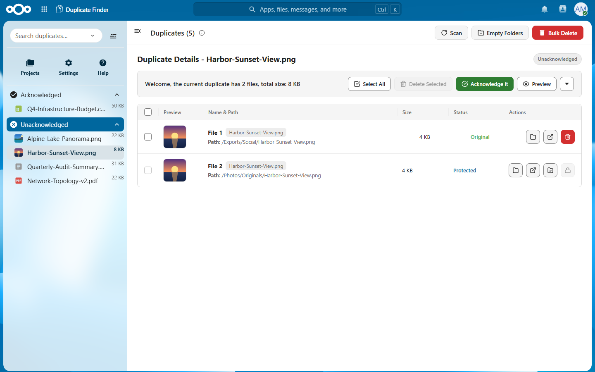
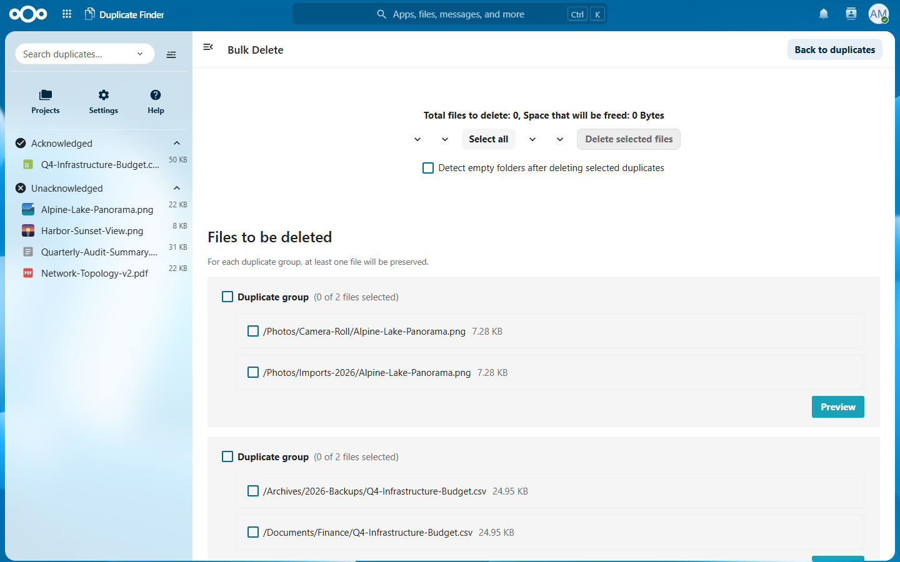
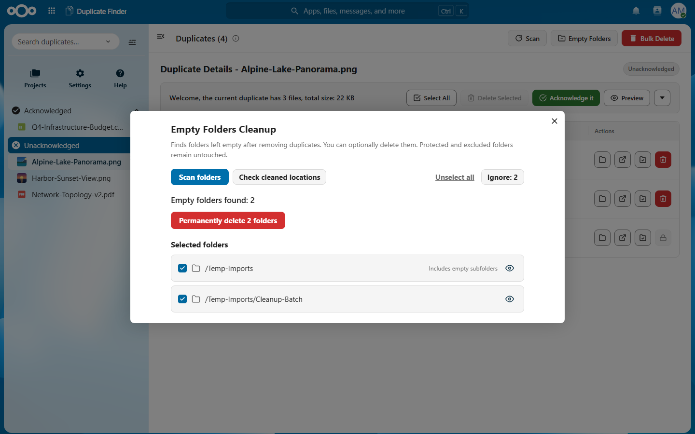
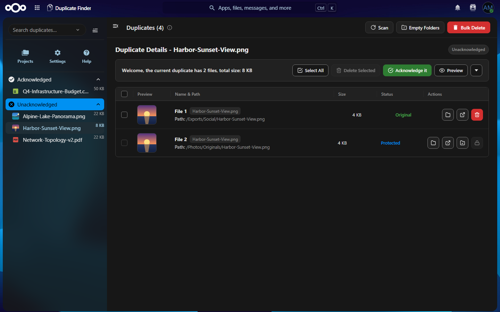

<!--
SPDX-FileCopyrightText: André Théo LAURET <andrelauret@eclipse-technology.eu>
SPDX-License-Identifier: CC0-1.0
-->

# Duplicate Finder

Find, review, and safely clean up duplicate files in Nextcloud (**Nextcloud 28 to 35**, licensed under `AGPL-3.0-or-later`).

Install directly from the [Nextcloud App Store](https://apps.nextcloud.com/apps/duplicatefinder) inside your Nextcloud instance.

## Preview

### Main Duplicate View (Light Mode)


### Bulk Delete & Dry-Run Preview


### Empty Folders Cleanup


### Main Duplicate View (Dark Mode)


## Usage

### Duplicate Detection

Duplicate Finder compares files by content hash (independent of filename or location) and supports three detection methods:

1. **Event-based detection**: Automatically checks uploaded or modified files as Nextcloud emits filesystem events.
2. **Background job detection**: Runs periodically via `OCA\DuplicateFinder\BackgroundJob\FindDuplicates` (default every 5 days / `432000` seconds) when cron, webcron, or AJAX background jobs are enabled.
3. **Command-based detection**: Run a full or targeted scan via `occ duplicates:find-all` (see [Command usage](#command-usage)).

When installing Duplicate Finder on an existing Nextcloud instance, running an initial CLI scan with `occ duplicates:find-all` is recommended.

### Live Photos

Deleting either component of a redundant Live Photo asks for confirmation to delete
both its still image and video. Another accessible, complete Live Photo with
identical contents in both components must remain. Separate copies of the image
and video without a valid pair do not qualify.

Origin-folder protection applies to both components. The last complete pair is
kept even when deletion of the last copy of an individual file was confirmed.
If the linked component is no longer in the user's files, including when it is
in trash, the remaining file uses the normal duplicate and last-copy checks.
An existing peer in another directory of the user's files remains protected.

### Bulk Delete & Dry-Run Preview

Click **Bulk Delete** in the app header to review and delete multiple duplicates in one operation:

- **Dry-run preview**: Displays the exact number of files to delete and total space that will be freed before confirming.
- **Sorting & size filters**: Sort by `Default`, `Size (largest first)`, or `Size (smallest first)`, and filter with `Min size` presets.
- **Selection helpers**: Use `Select all`, `Smart select` (select all except the first or last file in each group), or `Keep folder` (preserve files inside a chosen folder while selecting copies in other folders for deletion).
- **Safety guarantees**: At least one copy per duplicate group is always preserved, files inside Origin Folders remain protected, and the video component of a paired Live Photo cannot be deleted independently.
- **Post-cleanup empty folder detection**: Enable `Detect empty folders after deleting selected duplicates` to review folders left empty right after deletion.

### Empty Folders Cleanup

Click **Empty Folders** in the app header (or trigger it after Bulk Delete) to open **Empty Folders Cleanup**:

- Run **Scan folders** across your storage or **Check cleaned locations** after a cleanup.
- Review nested empty subfolders (`Includes empty subfolders`), ignore specific folders for future scans (`Ignore`, `Show ignored`, `Restore all`), or permanently delete selected empty folders.
- Protected Origin Folders, Excluded Folders, and external storage mounts are automatically skipped.

### Protected Files in Origin Folders

Configure **Origin Folders** in `Settings -> Origin Folders` to protect master copies from accidental deletion:

- Files in Origin Folders are marked as **Protected** in Duplicate Details and cannot be deleted through the UI or Bulk Delete.
- Ideal for photo libraries, archival masters, or critical shared documents.

### Ignoring Duplicates & Filtering

You can exclude specific folders or files from duplicate detection in three ways:

- **Excluded Folders (`Settings -> Excluded Folders`)**: Pick folders to ignore (including their subfolders) during scanning.
- **File Filters (`Settings -> Filters`)**: Add per-user **File Hash** filters (ignore exact file content) or **File Name Pattern** filters using `*` wildcards (for example `*.tmp` or `backup_*`).
- **`.nodupefinder` marker file**: Place an empty `.nodupefinder` file inside any folder to exclude that folder and its subfolders.

### Search, Sort & Filter

At the top of the navigation sidebar, you can narrow down **Unacknowledged** and **Acknowledged** duplicate groups:

- **Search modes**: Click the chevron in the search bar to switch between **Simple search**, **Wildcard search (`*`, `?`)** (e.g., `IMG*.jpg`), and **Regular expression** (e.g., `^IMG_\d{4}\.jpg$`).
- **Sort & minimum file size**: Click the sort/filter icon next to the search bar to sort by `Default`, `Size (largest first)`, or `Size (smallest first)`, or filter by preset sizes and custom `Min MB`.

### Projects

Projects let you focus duplicate scans on specific folders without scanning your entire storage.

1. Open **Projects -> Manage Projects** in the sidebar (or `Settings -> Projects`).
2. Click **Create New Project**, enter a name, and select one or more folders.
3. Click **Create Project**, then start a scan from the UI (**Start Scan**) or via CLI (`occ duplicates:find-all --user="<user>" --project=<id>`).

## Command usage

```text
occ [-v] duplicates:<action> [options]
```

Depending on your Nextcloud setup, invoke `occ` as `sudo -u www-data php occ ...` or `nextcloud.occ ...`. Refer to the [Nextcloud occ documentation](https://docs.nextcloud.com/server/latest/admin_manual/configuration_server/occ_command.html) for environment-specific details.

| Command | Purpose | Options |
|---|---|---|
| `duplicates:find-all` | Scan storage and index duplicate files | `-u, --user` (repeatable), `-p, --path` (repeatable, e.g., `--path="./Photos"`), `--project=<id>` (requires `--user`) |
| `duplicates:list` | List indexed duplicates per user | `-u, --user` (repeatable), `-s, --sort` (`default`, `size-desc`, `size-asc`), `-m, --min-size` (bytes or `500K`, `10M`, `1G`) |
| `duplicates:list-all` | Read-only admin report of duplicates across all users, sorted by wasted space | `--min-size` (default `1`), `-l, --limit` (default `100`, `0` for all), `--output` (`table` or `json`), `--include-shared`, `--ignore-shared` |
| `duplicates:folders` | List folders sharing identical duplicate file trees and content hashes | `-u, --user` (repeatable), `--min-files` (default `1`), `-m, --min-size` (default `0`, bytes or unit), `--json` |
| `duplicates:clear` | Clear indexed duplicate metadata from the database (does not delete files) | `-f, --force` (skip interactive confirmation) |

### Examples

```bash
# Scan all files for all users
occ duplicates:find-all

# Scan files for a specific user and path
occ duplicates:find-all --user="admin" --path="./Documents"

# Scan a specific project
occ duplicates:find-all --user="admin" --project=1

# List duplicates for a user, largest first, at least 10 MB
occ duplicates:list --user="admin" --sort=size-desc --min-size=10M

# Read-only admin report across all users (top 20 wasted groups >= 100 MB)
occ duplicates:list-all --min-size=100M --limit=20

# Export cross-user admin report as JSON
occ duplicates:list-all --output=json --limit=0 > duplicates.json

# Find duplicate folder trees containing at least 3 files and 50 MB total
occ duplicates:folders --user="admin" --min-files=3 --min-size=50M

# Export duplicate folder trees report as JSON
occ duplicates:folders --user="admin" --json > duplicate-folders.json

# Reset indexed duplicate database entries without touching stored files
occ duplicates:clear --force
```

## Config

Settings can be configured in the Nextcloud UI (`Settings -> Advanced Settings`, admin only) or via [occ config commands](https://docs.nextcloud.com/server/latest/admin_manual/configuration_server/occ_command.html#config-commands-label).

| Setting | Type | Default | Effect |
|---|---|---|---|
| `ignore_mounted_files` | boolean | `false` | When `true`, skips files on external storage mounts during hashing to avoid remote transfer overhead. |
| `disable_filesystem_events` | boolean | `false` | When `true`, disables real-time event-based detection on file upload/modification. |
| `backgroundjob_interval_find` | integer | `432000` (5 days) | Interval in seconds between automatic `FindDuplicates` background scans. |
| `backgroundjob_interval_cleanup` | integer | `172800` (2 days) | Interval in seconds between `CleanUpDB` database maintenance runs (removes stale index rows; never deletes user files). |

## Localization & Languages

Duplicate Finder ships with **40 complete Nextcloud UI locales at 100.0% runtime coverage (`542/542` keys)** (56 locales total across `l10n/` and `l10n-fallback/`) and **38 languages in `appinfo/info.xml`** (`<summary>` and `<description>` in strict parity).

At package time (`make appstore`), `scripts/merge_l10n_fallback.py` populates missing singular and plural keys from `l10n-fallback/` into the packaged `l10n/` directory without overwriting existing Transifex translations.

| Coverage Tier | Count | Locales at 100.0% (`542/542` keys) |
|---|---:|---|
| Priority locales | 16 | `fr`, `de`, `de_DE`, `es`, `it`, `pt_BR`, `pt_PT`, `nl`, `pl`, `ru`, `tr`, `ja`, `ko`, `zh_CN`, `ar`, `sv` |
| Extended locales | 9 | `da`, `sk`, `cs`, `uk`, `ro`, `id`, `el`, `en_GB`, `zh_HK` |
| Circle 3 locales | 15 | `fi`, `ca`, `zh_TW`, `nb`, `hu`, `sl`, `bg`, `hr`, `he`, `vi`, `th`, `sr`, `lt_LT`, `lv`, `et_EE` |

`appinfo/info.xml` store descriptions (38 languages): `en`, `ar`, `bg`, `ca`, `cs`, `da`, `de`, `el`, `es`, `et`, `fi`, `fr`, `he`, `hr`, `hu`, `id`, `it`, `ja`, `ko`, `lt`, `lv`, `nb`, `nl`, `pl`, `pt-br`, `pt-pt`, `ro`, `ru`, `sk`, `sl`, `sr`, `sv`, `th`, `tr`, `uk`, `vi`, `zh-hans`, `zh-hant`.

## Development

### Testing

```bash
# Install PHP dependencies and run PHPUnit suites
composer install
vendor/bin/phpunit
vendor/bin/phpunit --testsuite unit
vendor/bin/phpunit --testsuite integration

# Run localization, placeholder, plural-form, and info.xml parity tests
python3 -B -m unittest discover -s scripts -p "test_*.py" -v

# Preview non-destructive fallback merge without modifying tracked l10n/ files
python3 scripts/merge_l10n_fallback.py --target-dir l10n --dry-run
```

### Packaging for Nextcloud App Store

```bash
make build
make appstore
```

`make appstore` excludes development files (`scripts/`, `l10n-fallback/`, `node_modules/`, `vendor/`, config files) and merges `l10n-fallback/` into the packaged `l10n/` assets inside `build/artifacts/`.

#### Testing in the Devcontainer

When running integration tests inside the devcontainer:

1. A Nextcloud installation is available at `/var/www/nextcloud` with MariaDB configured.
2. Start services before running integration tests:
   ```bash
   service mariadb start
   service apache2 start
   ```

For more details on the test suite, see [tests/README.md](tests/README.md).

#### Live Photo integration tests with Docker

The root Compose file provides an isolated Nextcloud 35, MariaDB and Redis.
Test data is stored under `.nextcloud-dev`; no existing Nextcloud data is mounted.

```bash
docker compose up -d --build
docker compose exec nextcloud sh -c 'cd custom_apps/duplicatefinder && composer install'
docker compose exec -u www-data nextcloud php occ app:enable duplicatefinder
docker compose exec -u www-data -e NEXTCLOUD_PATH=/var/www/html nextcloud sh -c \
  'cd custom_apps/duplicatefinder && php vendor/bin/phpunit tests/Integration/LivePhotoDeletionIntegrationTest.php'
```

The integration suite uses synthetic image/video components with Nextcloud's
public Live Photo metadata. It exercises actual core deletion, retained pairs,
origin protection and concurrent authenticated HTTP requests with Redis locking.

The confirmation retry also needs verification with database locking, as used
when Redis is not configured. In this isolated test instance, temporarily add a
config override and run both confirmation cases through real HTTP requests:

```bash
docker compose exec -u www-data nextcloud php -r \
  'file_put_contents("config/zz-live-photo-db.config.php", "<?php\n\$CONFIG = [\"memcache.locking\" => \"\"];\n");'
docker compose exec -u www-data -e NEXTCLOUD_PATH=/var/www/html nextcloud sh -c \
  'cd custom_apps/duplicatefinder && php vendor/bin/phpunit --filter testConfirmationRetryReleasesTheDatabasePairMutex tests/Integration/LivePhotoDeletionIntegrationTest.php'
docker compose exec -u www-data nextcloud rm config/zz-live-photo-db.config.php
```

The test checks that the database mutex is released after each HTTP request and
that the remaining photo/video pair stays intact. PHPUnit's in-process cache is
not used as evidence of HTTP database locking.

To measure metadata query counts with 50 ordinary images:

```bash
docker compose exec -u www-data -e NEXTCLOUD_PATH=/var/www/html nextcloud sh -c \
  'cd custom_apps/duplicatefinder && php vendor/bin/phpunit tests/Integration/LivePhotoStatusQueryIntegrationTest.php'
```

After the checks, stop the isolated instance with `docker compose down`.

## Special thanks

Big thanks to @PaulLereverend @chrros95 @Routhinator

## Commercial Support & Custom Integration

Need custom features, enterprise integration, or priority support?
Maintained by **[Eclipse Technology](https://eclipse-technology.eu)** ([contact@eclipse-technology.eu](mailto:contact@eclipse-technology.eu)).
